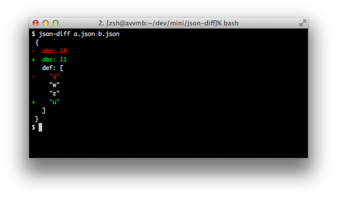

# JSON structural diff

Does exactly what you think it does:



## Installation

For the command-line tool:

```sh
    npm install -g json-diff
```

For use in a Node.js project:

```sh
npm install json-diff
```

## Usage

Simple:

```sh
    json-diff a.json b.json
```

Detailed:

```sh
    % json-diff --help

    Usage: json-diff [-vCjfonskKp] first.json second.json

    Arguments:
    <first.json>          Old file
    <second.json>         New file

    General options:
    -v, --verbose         Output progress info
    -C, --[no-]color      Colored output
    -j, --raw-json        Display raw JSON encoding of the diff
    -f, --full            Include the equal sections of the document, not just the deltas
        --max-elisions COUNT  Max number of ...s to show in a row in "deltas" mode (before
                                collapsing them)

    -o, --output-keys KEYS  Always print this comma separated keys, with their value, if they are
                            part of an object with any diff

    -x, --exclude-keys KEYS  Exclude these comma separated keys from comparison on both files

    -n, --output-new-only   Output only the updated and new key/value pairs (without marking them as
                            such). If you need only the diffs from the old file, just exchange the
                            first and second json.

    -s, --sort            Sort primitive values in arrays before comparing
    -k, --keys-only       Compare only the keys, ignore the differences in values
    -K, --keep-unchanged-values   Instead of omitting values that are equal, output them as they are
    -p, --precision DECIMALS  Round all floating point numbers to this number of decimal places prior
                                to comparison

    -h, --help            Display this usage information
```

In javascript (ES5):

```js
var jsonDiff = require('json-diff');

console.log(jsonDiff.diffString({ foo: 'bar' }, { foo: 'baz' }));
// Output:
//  {
// -  foo: "bar"
// +  foo: "baz"
//  }

// As above, but without console colors
console.log(jsonDiff.diffString({ foo: 'bar' }, { foo: 'baz' }, { color: false }));

// Raw output:
console.log(jsonDiff.diff({ foo: 'bar', b: 3 }, { foo: 'baz', b: 3 }));
// Output:
// { foo: { __old: 'bar', __new: 'baz' } }

// Passing in the "full" option:
console.log(jsonDiff.diff({ foo: 'bar', b: 3 }, { foo: 'baz', b: 3 }, { full: true }));
// Output:
// { foo: { __old: 'bar', __new: 'baz' }, b: 3 }
```

In javascript (ES6+):

```js
import { diffString, diff } from 'json-diff';

console.log(diffString({ foo: 'bar' }, { foo: 'baz' }));
console.log(diff({ foo: 'bar' }, { foo: 'baz' }));
```

## Features

- colorized, diff-like output
- fuzzy matching of modified array elements (when array elements are object hierarchies)
- "keysOnly" option to compare only the json structure (keys), ignoring the values
- "full" option to output the entire json tree, not just the deltas
- "outputKeys" option to always output the given keys for an object that has differences
- reasonable test coverage (far from 100%, though)

## Output Language in Raw-json mode ("full" mode)

### ARRAYS

Unless two arrays are equal, all array elements are transformed into 2-tuple arrays:

- The first element is a one character string denoting the equality ('+', '-', '~', ' ')
- The second element is the old (-), new (+), altered sub-object (~), or unchanged (' ') value

```sh
    json-diff.js --full --raw-json <(echo '[1,7,3]') <(echo '[1,2,3]')
         [ [ " ", 1 ], [ "-", 7 ], [ "+", 2 ], [ " ", 3 ] ]
```

```sh
    json-diff.js --full --raw-json <(echo '[1,["a","b"],4]') <(echo '[1,["a","c"],4]')
         [ [ " ", 1 ], [ "~", [ [ " ", "a" ], [ "-", "b" ], [ "+", "c" ] ] ], [ " ", 4 ] ]
```

- If two arrays are equal, they are left as is.

### OBJECTS

**Object property values:**

- If equal, they are left as is
- Unequal scalar values are replaced by an object containing the old and new value:

```sh
    json-diff.js --full  --raw-json <(echo '{"a":4}') <(echo '{"a":5}')
        { "a": { "__old": 4, "__new": 5 } }
```

- Unequal arrays and objects are replaced by their diff:

```sh
    json-diff.js --full  --raw-json <(echo '{"a":[4,5]}') <(echo '{"a":[4,6]}')
        { "a": [ [ " ", 4 ], [ "-", 5 ], [ "+", 6 ] ] }
```

**Object property keys:**

- Object keys that are deleted or added between two objects are marked as such:

```sh
    json-diff.js --full  --raw-json <(echo '{"a":[4,5]}') <(echo '{"b":[4,5]}')
        { "a__deleted": [ 4, 5 ], "b__added": [ 4, 5 ] }
    json-diff.js --full  --raw-json <(echo '{"a":[4,5]}') <(echo '{"b":[4,6]}')
        { "a__deleted": [ 4, 5 ], "b__added": [ 4, 6 ] }
```

## Non-full mode

- In regular, delta-only (non-"full") mode, equal properties and values are omitted:

```sh
    json-diff.js --raw-json <(echo '{"a":4, "b":6}') <(echo '{"a":5,"b":6}')
        { "a": { "__old": 4, "__new": 5 } }
```

- Equal array elements are represented by a one-tuple containing only a space " ":

```sh
    json-diff.js --raw-json <(echo '[1,7,3]') <(echo '[1,2,3]')
        [ [ " " ], [ "-", 7 ], [ "+", 2 ], [ " " ] ]
```

## Contribution policy

1. This project is maintained thanks to your contributions! Please send pull requests.

2. I will merge any pull request that adds something useful, does not break existing things, has reasonable code quality and provides/updates tests where appropriate.

3. Anyone who gets a significant pull request merged gets commit access to the repository.

## Tests

```sh
npm ci
npm test
```

With Node.js 26.4.0, the bundled Mocha/yargs test runner fails to load (`require is not defined in ES module scope`). This is a test-tool compatibility issue; the library examples can be run directly with Node.

The examples above cover changed properties, added/deleted keys, array matching and full versus delta output. See [test](test/) for the full suite.

## Change Log
- 1.0.6 Comment out another debugging output.
- 1.0.5 Comment out debugging output(!)
- 1.0.4 Fix typo that broke -o/--output-keys
- 1.0.3 Change from cli-color to colors to reduce package size.
- 1.0.2 Add colorize and colorizeToCallback to module exports (Fix bug #103)
- 1.0.1 Bug fixes: Properly compare date objects; properly exclude keys with -x; improve README readability.
- 1.0.0 Properly distinguish list elements with identical strings of different types e.g. `["true"]` vs `[true]`, `["0"]` vs `[0]` (enabled by switching to a new difflib)
- 0.10.0 Add --exclude-keys
- 0.9.1 Fix bug #88
- 0.9.0 Add --output-new-only option
- 0.8.0 Add --keep-unchanged-values option
- 0.7.4 Fix bug #76
- 0.7.3 Revert use of ?? operator in 0.7.2 (which caused a breaking change)
- 0.7.2 Add --maxElisions and --precision options.
- 0.7.1 Add --output-keys option.
- 0.7.0 Add --sort option.
- 0.6.3 Fix ticket #68.
- 0.6.2 Provide examples of setting mode from code.
- 0.6.1 Return exit code 0. Update cli-color to the latest version.
- 0.6.0 Convert project code to ES6.
- 0.5.5 Fix bug in scalarize fuzzy compare logic.
- 0.4.0 Add --keys-only feature.

## License

© Andrey Tarantsov. Distributed under the MIT license.
